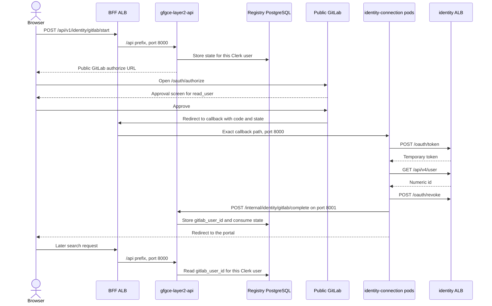

# Layer 2 GitLab identity connection

This plan covers the ticket that registers a confidential GitLab OAuth application, stores its client secret, and gives one Layer 2 workload a private path for the authorization-code flow. The lasting product result is a numeric GitLab user id for a signed-in Clerk user. The temporary GitLab token is used once and revoked.

The callback workload is a second Deployment, `gfgce-layer2-identity-connection`. It runs the existing `gfgce-layer2/api` image with command `uvicorn services.api.identity_app:app`. There is no new Dockerfile and no new ECR repository. `gfgce-layer2-api` keeps Clerk, `POST /api/v1/identity/gitlab/start`, and the permission resolver for #75. It does not call GitLab for this flow. `gf-registry-ui` sends the browser to GitLab and never sees the client secret or the user token. `gf-admin-api` is unchanged.

The private GitLab origin is an internal Application Load Balancer. Its listener allows only `/oauth/token`, `/api/v4/user`, and `/oauth/revoke`. Every other path returns 404 at the load balancer.

Apply order:

1. `gf-iac-gitlab` publishes the identity ALB, the pod security group, and the platform-contract keys.
2. An administrator registers the GitLab application, stores the client in 1Password, and copies that item into AWS Secrets Manager.
3. `gfc-iac` creates the identity Deployment's role, grants that role the secret, attaches the identity pod security group only to those pods, and routes the public callback to them.
4. `gf-registry-api` adds `start` and the internal complete call on the API process, and the code exchange on `identity_app`.
5. A developer on an allowlisted network runs the live development test.

## Decision

| Choice | What this plan does |
|---|---|
| Identity workload | `gfgce-layer2-identity-connection` in namespace `layer2`, service account `gfgce-layer2-identity-connection`, role `gfgce-layer2-<env>-identity-connection-irsa`, image `gfgce-layer2/api` |
| Search and permission resolver | Stays on `gfgce-layer2-api`, service account `gfgce-layer2-api`, role `gfgce-layer2-<env>-api-irsa`. That role does not receive the identity secret or the identity pod security group |
| Browser authorize URL | Existing public GitLab origin, `https://<gitlab_fqdn>/oauth/authorize` |
| Backend GitLab origin | New private origin, `https://gitlab-identity-connection.<env-subdomain>`, terminated on an internal ALB |
| Allowed private paths | Exact `/oauth/token`, `/api/v4/user`, and `/oauth/revoke`. Every other path is a fixed 404 on the ALB |
| OAuth application | Created in the GitLab admin UI, kept confidential and untrusted, scope `read_user` only |
| Client secret | 1Password item first, then Secrets Manager path `/<project>/<env>/gitlab/identity-connection`. Terraform creates the secret and ignores its value. Only the identity role can read it |
| Mapping storage | The API writes `gitlab_user_id` when the identity pods call the internal complete route. `_resolve_gitlab_user_id` reads that row. #61 private scopes stay out of this change |

`gfgce-layer2-api` already verifies Clerk and already owns `AuthenticatedUser.gitlab_user_id`. Permission-resolver calls stay on `PERMISSION_RESOLVER_GITLAB_API_URL`. The identity pods use `GITLAB_IDENTITY_CONNECTION_URL` for the three user-token calls. The API pods cannot open the identity ALB. The identity pods cannot open the permissions listener.

### Naming

`gitlab-identity-connection` is the stem for this user connection. A later GitLab OAuth client uses a different stem, so the two do not share keys. `gitlab_internal_url` stays the shared internal GitLab origin. Hyphens, underscores, and capitals follow the place the name is used.

| Kind | Name |
|---|---|
| Private hostname | `gitlab-identity-connection.<env-subdomain>` |
| Contract URL | `gitlab_identity_connection_url` |
| Contract pod group | `identity_connection_pod_security_group_id` |
| Deployment | `gfgce-layer2-identity-connection` |
| Service account | `gfgce-layer2-identity-connection` |
| IRSA role | `gfgce-layer2-<env>-identity-connection-irsa` |
| 1Password item | `gfgce-layer2/<env>/gitlab/identity-connection` |
| Secrets Manager | `/<project>/<env>/gitlab/identity-connection` |
| Secret name env | `GITLAB_IDENTITY_CONNECTION_SECRET_NAME` on the identity ConfigMap only |
| Origin env | `GITLAB_IDENTITY_CONNECTION_URL` on the identity ConfigMap only |
| Authorize URL env | `GITLAB_IDENTITY_AUTHORIZE_URL` on the API ConfigMap |
| Client id env | `GITLAB_IDENTITY_CONNECTION_CLIENT_ID` on the API ConfigMap. The value is public in the authorize URL |
| Callback env | `GITLAB_IDENTITY_CONNECTION_REDIRECT_URI` |
| Scope env | `GITLAB_IDENTITY_CONNECTION_SCOPE` |

### How a connected account reaches the other workloads

The identity pods and the API share one state row and one cluster-internal call. They do not share a service account, a security group, or the client secret. The identity pods do not open PostgreSQL. They pass `state` and the numeric id to the API on port 8001. The API writes the row. A later request on the API reads it. The permission resolver stays on the API pods and uses the permissions listener.



The identity ALB forwards only those three paths to Workhorse. A call to any other path, including `/api/v4/projects`, ends at the ALB.

What happens when a user connects:

1. The user is already signed in with Clerk. The browser calls `POST /api/v1/identity/gitlab/start`. The tunnel delivers it to the BFF ALB, and the `/api` prefix lands on `gfgce-layer2-api` port 8000.
2. The API verifies the Clerk session and stores a single-use `state` for that Clerk `user_id`. It returns the public GitLab authorize URL with `scope=read_user` and that state. The client id is in this URL. The client secret stays on the identity pods.
3. The browser opens the public GitLab site. The user approves `read_user`.
4. GitLab redirects the browser to `/api/v1/identity/gitlab/callback` with `code` and `state`. The BFF ALB sends that exact path to the identity-connection Service. Other `/api` paths still go to the API.
5. The identity pod reads the client secret with its own role. It posts the code to `https://gitlab-identity-connection.<env>/oauth/token`, calls `GET /api/v4/user`, reads the numeric `id`, posts the token to `/oauth/revoke`, and drops the token. The identity ALB accepts this pod because it carries `identity_connection_pod_security_group_id`. These pods do not carry the search-API pod group, so the permissions listener rejects them.
6. The identity pod calls `gfgce-layer2-api` port 8001, `POST /internal/identity/gitlab/complete`, with the state and the numeric id. Port 8001 is not on the BFF. The API NetworkPolicy allows it only from the identity pods. The API checks the state, writes `gitlab_user_id` on that Clerk user, and marks the state used.
7. The identity pod redirects the browser to the portal. The redirect carries no code, token, or GitLab id.
8. On a later search request, the browser takes the `/api` path to the API again. The API verifies Clerk, reads `gitlab_user_id` from PostgreSQL, and the permission resolver on those API pods calls the permissions listener. The identity pods are not in that request.

A GitLab error, a state mismatch, a non-numeric `id`, or an ALB 404 stops the flow before the complete call. The API leaves the stored mapping empty, and the user keeps only `layer2:public`.

## `gf-iac-gitlab`

GitLab Community Edition already serves `/oauth/authorize`, `/oauth/token`, `/api/v4/user`, and `/oauth/revoke` on the webservice. This repo does not register a Layer 2 application, and its current OAuth file is the other direction: GitLab signs users in with Google and Microsoft (`terraform/gfgce-ha/oauth.tf`). Leave that file alone.

### Private listener

Add the identity listener in `terraform/gfgce-ha/gitlab-layer2-listeners.tf`. Permissions and extraction stay Network Load Balancers. This listener is an internal Application Load Balancer because an NLB forwards TCP and cannot refuse a path.

- Hostname `gitlab-identity-connection.<env-subdomain>`, for example `gitlab-identity-connection.dev.gfgce-ha.brainpool.ai`.
- One ACM certificate for that name only. Publish the validation CNAME to Cloudflare the same way the permissions and extraction certificates do. Leave hostname verification on. This certificate is the ALB certificate.
- A pod security group with no rules of its own, `identity_connection_pods`. It identifies the identity-connection pods.
- An ALB security group that accepts TCP 443 only from that pod group.
- An HTTPS listener. The default action is a fixed 404. Three rules, with no `*` in the path pattern, forward only `/oauth/token`, `/api/v4/user`, and `/oauth/revoke`. `/api/v4/user` must not match `/api/v4/users` or `/api/v4/user/keys`.
- The forward action sends HTTP to Workhorse on 8181, the port the current health checks already use. Set the Host header to a name Workhorse accepts.
- The target-group health check is `/-/readiness` from the ALB. That path is not a listener rule, so identity pods cannot call it through the hostname.
- A private Route 53 CNAME in the existing private zone, aimed at the ALB. Do not publish this name to public Cloudflare DNS.

The identity client still refuses any host or path outside those three URLs. The ALB is what enforces the list when the client is wrong, and when some other credential is presented on this connection.

### Platform contract

Add two optional keys in `terraform/gfgce-ha/outputs-platform.tf`:

- `gitlab_identity_connection_url` = `https://gitlab-identity-connection.<env-subdomain>`
- `identity_connection_pod_security_group_id` = the new pod security group id

Keep `contract_version` at 1. `gfc-iac` already treats missing permissions and extraction keys as optional. Do the same here so an older parameter still plans.

### Application registration

Do this once per environment. Record the steps in `gf-iac-gitlab/README.md` and `gfc-iac/README.md`. GitLab shows the client secret once. 1Password is the operator copy. AWS Secrets Manager is the only copy the identity workload reads.

There is no GitLab provider in this repo. A `gitlab_application` resource would return the client secret into Terraform state and would delete the application, and every user consent, on destroy. The existing `oauth.tf` comments explain the same lifecycle problem for Google and Azure.

Do not put this client into the 1Password Environment that `terraform.yml` syncs to `/gfgce-layer2/<env>/deployment`. That Environment is loaded into the GitHub Actions job and into Terraform. The Clerk key uses that path and therefore lands in Terraform state. This secret must not.

Admin steps:

1. For dev, the callback is `https://portal.dev.gfgce-ha.brainpool.ai/api/v1/identity/gitlab/callback`. GitLab stores it exactly. Prod uses its own public hostname.
2. In GitLab, open Admin, Applications, and create an application.
   - Name: `Layer 2 identity connection`
   - Redirect URI: `https://portal.dev.gfgce-ha.brainpool.ai/api/v1/identity/gitlab/callback` for dev. Prod uses its own public hostname.
   - Confidential: yes
   - Trusted: unchecked
   - Scopes: `read_user` only
3. Copy the Application ID and Secret from the GitLab page before leaving it. GitLab does not show the secret again.
4. Dev already sets the redirect variable to `https://portal.dev.gfgce-ha.brainpool.ai/api/v1/identity/gitlab/callback` and `gitlab_identity_connection_application_id` to the registered Application ID. Apply. Both ConfigMaps receive that Application ID. Roll the API and identity Deployments after they exist.
5. In 1Password, create a vault item named `gfgce-layer2/<env>/gitlab/identity-connection`. Limit it to the operators who administer this connection. Store `client_secret`, `authorize_url`, `token_url`, `user_url`, `revoke_url`, `redirect_uri`, and `scope`. The Application ID is the Terraform variable and is not a field in this item. The token, user, and revoke URLs use `https://gitlab-identity-connection.<env-subdomain>`. The authorize URL uses the public GitLab origin.
6. Wait until Terraform has created the empty secret `/<project>/<env>/gitlab/identity-connection`. Terraform does not manage a secret version.
7. On an administrator workstation, signed in to 1Password and AWS, read the item with `op read` and write it with `aws secretsmanager put-secret-value`. That write creates the first version. Do not print the secret, do not pass it as `TF_VAR_*`, and do not commit the shell command with the value filled in.
8. Confirm with `aws secretsmanager describe-secret` that a version exists. Confirm a pod using `gfgce-layer2-<env>-identity-connection-irsa` can call `GetSecretValue`. Confirm the API role, the extraction-worker role, and the admin role cannot. Do not fetch the secret string in CI logs. `terraform state show aws_secretsmanager_secret.gitlab_identity_connection` shows the ARN and name.
9. Start the live development test. A wrong redirect URI or a trusted checkbox shows up there: GitLab either rejects the callback or skips the approval screen.

### Browser access

Users open `/oauth/authorize` on the public GitLab hostname. That hostname is already served by the internet-facing load balancer and limited to `allowed_ip_cidrs`. Do not point browsers at `gitlab-identity-connection`. That name is private, and its load balancer would reject them.

Confirm with one allowlisted browser that GitLab renders the authorization screen and names the `read_user` scope. A trusted application would skip that screen. Leave trusted off.

## `gfc-iac`

This repo delivers the secret, the IAM grant, and the pod security group to `gfgce-layer2-identity-connection`. It delivers only the non-secret authorize settings to `gfgce-layer2-api`, and it routes the public callback to the identity Service.

### Secret

Add `aws_secretsmanager_secret.gitlab_identity_connection` in `stacks/application/identity-connection-iam.tf`.

- Name: `/<project>/<env>/gitlab/identity-connection`
- Container only. Do not manage `aws_secretsmanager_secret_version`. The operator JSON, written with `put-secret-value`, is:

```json
{
  "client_secret": "<secret shown once on the GitLab page>",
  "authorize_url": "https://<gitlab_fqdn>/oauth/authorize",
  "token_url": "https://gitlab-identity-connection.<env>/oauth/token",
  "user_url": "https://gitlab-identity-connection.<env>/api/v4/user",
  "revoke_url": "https://gitlab-identity-connection.<env>/oauth/revoke",
  "redirect_uri": "https://portal.dev.gfgce-ha.brainpool.ai/api/v1/identity/gitlab/callback",
  "scope": "read_user"
}
```

Terraform creates the empty container. The first `put-secret-value` creates the version, and refresh cannot store the value because the version is not a Terraform attribute. The Application ID is `gitlab_identity_connection_application_id` on both ConfigMaps. The identity pods read `client_secret` from Secrets Manager at runtime with their IRSA role. Do not copy the Clerk pattern in `api-workload.tf`, which puts `CLERK_SECRET_KEY` into a Kubernetes secret and therefore into Terraform state.

In the same file, create role `gfgce-layer2-<env>-identity-connection-irsa`. The trust policy limits it to `system:serviceaccount:layer2:gfgce-layer2-identity-connection`. Grant `secretsmanager:GetSecretValue` and `DescribeSecret` on this secret ARN only, plus that role's own CloudWatch log group. Do not add the statement to `aws_iam_role_policy.api`, the extraction-worker role, the admin role, or the normalizer role.

### Identity workload

`stacks/application/identity-connection-workload.tf` creates:

- ServiceAccount `gfgce-layer2-identity-connection`, annotated with the identity role.
- ConfigMap `gfgce-layer2-identity-connection-config` with `GITLAB_IDENTITY_CONNECTION_SECRET_NAME`, `GITLAB_IDENTITY_CONNECTION_CLIENT_ID`, `GITLAB_IDENTITY_CONNECTION_URL`, `GITLAB_IDENTITY_CONNECTION_REDIRECT_URI`, and `GITLAB_IDENTITY_CONNECTION_SCOPE`. The client id is the same public variable the API ConfigMap receives. No Clerk keys. No `PERMISSION_RESOLVER_GITLAB_API_URL`.
- ClusterIP Service `gfgce-layer2-identity-connection` on port 8000.
- `SecurityGroupPolicy` `gfgce-layer2-identity-connection-sgp`, selecting `app.kubernetes.io/name: gfgce-layer2-identity-connection`, with the node security group and `identity_connection_pod_security_group_id` only.
- A NetworkPolicy that allows the BFF ALB subnet CIDRs to reach these pods on port 8000.

Manifests under `k8s/identity-connection/`:

- `deployment.yaml`. Image name `gfgce-layer2-api`. Command `uvicorn services.api.identity_app:app --host 0.0.0.0 --port 8000`. The projected IRSA token matches the API Deployment. No Clerk secret volume.
- `pdb.yaml`
- `network-policy.yaml` for egress to DNS and TCP 443, and to the API pods on port 8001. No PostgreSQL egress.
- `kustomization.yaml`

Add the directory to `k8s/kustomization.yaml`. In `.github/workflows/cd-deploy.yml`, add `k8s/identity-connection` to the existing `api` catalog entry and add the identity ServiceAccount, ConfigMap, and Service to its prerequisites. One published digest of `gfgce-layer2/api` then rolls both Deployments.

### API config and the complete port

On ConfigMap `gfgce-layer2-api-config` in `stacks/application/api-workload.tf`, add non-secret settings only:

- `GITLAB_IDENTITY_AUTHORIZE_URL` = the public GitLab authorize URL
- `GITLAB_IDENTITY_CONNECTION_CLIENT_ID` = the application id
- `GITLAB_IDENTITY_CONNECTION_REDIRECT_URI` = the exact callback URL
- `GITLAB_IDENTITY_CONNECTION_SCOPE` = `read_user`

Do not set `GITLAB_IDENTITY_CONNECTION_SECRET_NAME` or `GITLAB_IDENTITY_CONNECTION_URL` on this ConfigMap. Keep `PERMISSION_RESOLVER_GITLAB_API_URL` on the permissions origin.

`k8s/api/deployment.yaml` listens on port 8001 for the complete route. `k8s/api/network-policy.yaml` allows ingress on 8001 only from pods labeled `app.kubernetes.io/name: gfgce-layer2-identity-connection`. Port 8001 is not registered on the BFF or the private API ingress.

### Pod security groups

Leave `stacks/application/gitlab-access.tf` as it is. The API policy keeps the search-API pod group and the node group. It does not gain `identity_connection_pod_security_group_id`. The VPC CNI allows one `SecurityGroupPolicy` per pod, and the identity pods have their own policy in `identity-connection-workload.tf`.

Leave the extraction-worker policy unchanged. Admin API pods, the normalizer, and cloudflared do not receive the identity group.

### Contract reader

In `modules/platform-contract/main.tf`, `outputs.tf`, and `tests/contract.tftest.hcl`, read the two new keys the same way as `gitlab_permissions_url` and `search_api_pod_security_group_id`: null until `gf-iac-gitlab` republishes the parameter, HTTPS origin when set, security group id when set, and distinct from the permissions, extraction, and internal origins.

### Callback URL

The redirect URI has to be a public HTTPS URL. GitLab sends the user's browser there. For dev that URL is `https://portal.dev.gfgce-ha.brainpool.ai/api/v1/identity/gitlab/callback`. The private names `layer2-api.dev.gfgce-ha.brainpool.ai` and `layer2-bff.dev.gfgce-ha.brainpool.ai` are not that URL. `bff_private_hostname` is still commented out in `stacks/application/vars/dev.tfvars`, so the Cloudflare tunnel is not created yet.

Pick the callback only after the public Layer 2 origin exists, and store that exact string in the GitLab application and in `GITLAB_IDENTITY_CONNECTION_REDIRECT_URI`. Path:

`/api/v1/identity/gitlab/callback`

In `stacks/application/bff-ingress.tf`, add that exact path on the BFF Ingress, listed before the `/api` prefix, with backend Service `gfgce-layer2-identity-connection`. The `/api` prefix continues to target `gfgce-layer2-api`.

### Rotation

Document this beside the extraction-worker rotation section in `gfc-iac/README.md`.

- In GitLab, regenerate the application secret. The old secret stops working immediately.
- Replace `client_secret` on the 1Password item. Leave the URLs, `redirect_uri`, and scope as they are. The Application ID stays on the Terraform variable.
- Copy that item to `/<project>/<env>/gitlab/identity-connection` with `put-secret-value`, the same way as the first registration.
- Restart `deployment/gfgce-layer2-identity-connection` if that process caches the secret. Do not restart the API for this secret, and do not rebuild `gf-registry-ui`. The UI never contains the secret.
- Emergency replacement is the same procedure. Regenerating the secret in GitLab is the revocation. In-flight authorization codes fail at token exchange, and no private GitLab scope is added.

## `gf-registry-api`

One image, two processes. `services/api/app.py` stays the search API. `services/api/identity_app.py` is the callback process. The image's Dockerfile command stays `uvicorn services.api.app:app`. The identity Deployment overrides it.

This change writes the Clerk-to-GitLab row because the callback no longer runs in the API process. The identity pods hand the numeric id to the API, and the API stores it. #61 still owns private project scopes. A failed or abandoned callback leaves `gitlab_user_id` empty and leaves `scopes` as `layer2:public`.

### Client

Add `services/api/httpclient/gitlab_identity.py`, imported only by `identity_app`. It:

- Loads the secret from `GITLAB_IDENTITY_CONNECTION_SECRET_NAME` at request time.
- Exchanges the code with `POST` to the secret's `token_url`, using HTTP Basic auth. The username is `GITLAB_IDENTITY_CONNECTION_CLIENT_ID`. The password is `client_secret` from the secret. A `client_id` field in the JSON is ignored.
- Calls `GET` on the secret's `user_url` with the temporary bearer token and reads integer `id`.
- Calls `POST` on the secret's `revoke_url` for that token, then drops the token.
- Uses the default TLS trust store and checks the hostname. No `verify=False`.
- Allows only those three URLs. Reject any other path, any other host, and any scope other than `read_user`.
- Refuses to run if `GITLAB_IDENTITY_CONNECTION_URL` equals the permissions URL, the extraction URL, or `gitlab_internal_url`.
- Logs the GitLab status code and the path. Does not log the query string, the authorization code, the JSON body, the client secret, or the access token.

`services/api/middleware/auth.py` stays on the API process. `_resolve_gitlab_user_id` reads the stored row. Tests that need a connected principal keep stubbing that function when the row is absent.

### Routes

On `services/api/app.py`:

- `POST /api/v1/identity/gitlab/start` requires `get_current_user`. It stores `state` against the Clerk `user_id` and returns the authorize URL built from the API ConfigMap. It does not read the client secret and it does not call GitLab.
- `POST /internal/identity/gitlab/complete` listens on port 8001. It accepts `state` and a numeric `gitlab_user_id`, checks that the state is unused, writes the id, and consumes the state. It does not accept a Clerk token. The NetworkPolicy is what limits the caller to the identity pods.

On `services/api/identity_app.py`:

- Health routes `/livez` and `/readyz`, so the BFF target group can use the Ingress health check.
- `GET /api/v1/identity/gitlab/callback` reads `code` and `state`, runs the exchange, and on success calls `http://gfgce-layer2-api:8001/internal/identity/gitlab/complete`. It then redirects the browser to the portal. The redirect carries no code, token, or GitLab id.

On any GitLab error, state mismatch, non-numeric `id`, or ALB 404, do not call complete. The response is an error redirect, and scopes stay `layer2:public`.

### Live development test

Run this against dev GitLab from an allowlisted browser, signed in as a real dev user.

1. Call `start` on `gfgce-layer2-api` with the Clerk session and open the returned URL.
2. Confirm GitLab shows the approval screen for `read_user`.
3. Approve. The browser lands on the portal redirect. The stored row for that Clerk user contains a numeric `id`, and the next authenticated API request carries it on `AuthenticatedUser.gitlab_user_id`.
4. Confirm identity-pod logs have no code and no token.
5. Confirm a second use of the same code fails and does not write a second row.
6. Confirm the revoked token receives 401 from `GET /api/v4/user` on the identity hostname.
7. From the identity role, `GetSecretValue` on the identity secret succeeds. From the API role and the extraction worker role, it is denied.
8. From an API pod, TLS to `gitlab-identity-connection` fails. The permissions hostname still works from the API pods and fails from the identity pods.
9. From an identity pod, `GET /api/v4/projects` on the identity hostname returns 404 from the ALB. `POST /oauth/token`, `GET /api/v4/user`, and `POST /oauth/revoke` reach Workhorse.

## `gf-registry-ui`

No change in this plan. The portal signs users in with Clerk and has no GitLab OAuth client. Secret rotation therefore cannot require a frontend rebuild.

The live test uses the authorize URL returned by the API. A later "Connect GitLab" control only needs to call `POST /api/v1/identity/gitlab/start` and navigate to that URL.

## `gf-admin-api`

No change. Its GitLab client uses a bot token to create and delete test projects. The ticket forbids reusing that token and forbids using the permission-resolver credential. The admin deployment is a different service account and must not receive the identity secret or the identity pod security group.

## Gaps against the ticket

The path allowlist and the separate workload are in this plan. The ALB enforces `/oauth/token`, `/api/v4/user`, and `/oauth/revoke`. `gfgce-layer2-identity-connection` is the only workload that can open that listener and the only role that can read the client secret.

### 1. The OAuth application is registered by hand

The ticket says to register a confidential, untrusted application with the exact callback and `read_user`. This plan does that in the GitLab admin UI and documents it, instead of creating it from Terraform.

Reason: this repo has no GitLab provider, and putting the application in Terraform would store the client secret in state and destroy user consents on teardown.

Options:

- Add the GitLab provider and `gitlab_application`. The secret appears in state unless a second, awkward export step strips it. Destroy becomes dangerous.
- Keep manual registration. The acceptance criterion is still met, but it is an operator step rather than a pull request.

This plan keeps manual registration. 1Password holds the operator copy. Secrets Manager holds the runtime copy. Neither Terraform nor CI receives the value.

### 2. Browser access depends on the existing GitLab allowlist

The ticket says users can reach `/oauth/authorize` and see an approval step. This plan uses the public GitLab site as it is. Users outside `allowed_ip_cidrs` cannot open that page.

Reason: opening the private listener to the internet would give browsers a second front door. Widening the allowlist is a GitLab access decision, not an identity-connection decision.

Options:

- Add the user networks to `allowed_ip_cidrs`. That also exposes the rest of the public GitLab UI to those networks.
- Leave the allowlist and treat "users" as people who can already sign in to GitLab.

This plan leaves the allowlist.

### 3. The dev public callback is set; the tunnel is not

The dev callback is `https://portal.dev.gfgce-ha.brainpool.ai/api/v1/identity/gitlab/callback`. The BFF private hostname is not enabled in dev, so the Cloudflare tunnel and the callback load balancer are not created yet.

Reason: GitLab will reject the redirect unless the registered URI matches character for character, and a private Route 53 name is not reachable by the browser.

The application can be registered with that dev URL. Browsers cannot finish the callback until the tunnel exists. The rest of the infrastructure can still be applied.

### 4. No registry UI control

The ticket's browser step needs somewhere to start. This plan starts from the API response so the frontend image does not contain OAuth material.

Reason: `gf-registry-ui` has no GitLab OAuth code, and the portal is still a coming-soon page. A button is presentation on top of `start`.

Options:

- Add a portal action that calls `start` and redirects. Users get a visible control. The UI change is small and must be redeployed when the button ships, not when the secret rotates.
- Keep the UI out of this ticket. The live test is an operator with a Clerk session.

This plan keeps the UI out.

### 5. Rotation is a documented procedure

The ticket asks for rotation and emergency revocation to be documented and tested without rebuilding the frontend. This plan does that. It may restart the identity-connection pods if they cache the secret. It does not rotate the secret automatically.

Reason: GitLab application secrets do not expire on the same 90-day bot-token schedule, and regenerating one is an admin action that should not be scripted against the GitLab admin API from this workload. The identity workload is deliberately limited to `read_user`.

Options:

- Cache nothing and read Secrets Manager on every callback. Rotation then needs no restart. More calls to Secrets Manager, and a revoked secret fails the next callback immediately.
- Cache for the life of the process and restart after `put-secret-value`. Fewer calls, and a short window where old pods still hold the previous secret. GitLab has already rejected the old secret, so those pods fail closed.

This plan reads the secret on each callback, so a restart is unnecessary. The README should still say to restart `deployment/gfgce-layer2-identity-connection` if a future change adds a cache.
